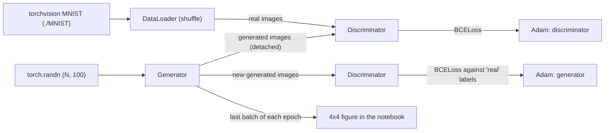

# nhl-stenden-debugging: documentation

A solved Python debugging assignment, named for NHL Stenden (`README.md:3-5`).
It has four short exercises, each with a planted bug. The corrected code is in one
Jupyter notebook, and written answers cover the two questions each exercise asks.
The repository installs nothing and gives nothing to other projects
(`recipe.ps1:16-17`). Who set the assignment and how it was graded is not recorded
(see Open questions in [SPEC.md](../SPEC.md)).

## Status

- Last change to the project's own files: 2026-11-07. Commits `a9bdcc7` and
  `2b0172b` edited `README.md`, and `5ca926d` moved the PDFs and PNGs to Git LFS.
  The notebook last changed on 2026-03-30 (`03cbc40`) and `ANSWERS.md` on
  2026-08-07 (`9748277`). The branch tip `4483888` (2026-11-08) is a merge.
- Tests: there are none for the notebook or the answers. `.claude/pytest.ini:2`
  says the repository has no tests yet, and `pytest --collect-only` over `.claude`
  reported "no tests collected" (exit 5) on 2026-11-18.
- CI: the standard Gitea workflows in `.gitea/workflows/`. For example,
  `test.yaml:56` runs `.\recipe.ps1 test` on a `windows` runner (`test.yaml:16`).
  They check the tooling, not the notebook. The files do not say whether a runner
  serves this repository.
- Missing: the original buggy code is not kept, only the fixed version (the
  `# Fixed:` comments at `debugging_solution.ipynb:771,779,799`). There is no
  requirements file. `README.md:19` says the notebook was not run when the
  repository was moved into the lab.

## Layout

| Path | Content |
|---|---|
| `debugging_solution.ipynb` | the notebook: 11 code cells and 13 Markdown cells, with saved outputs |
| `debugging_solution.pdf` | a 62-page print of the notebook (producer "Microsoft: Print To PDF", no text layer) |
| `ANSWERS.md` | answers to the eight questions, six GAN output images, and the PC characteristics |
| `ANSWERS.pdf` | a printed version of the answers |
| `image.png`, `image copy.png` ... `image copy 5.png` | the six images that `ANSWERS.md:44-54` shows |
| `README.md` | the project summary |
| `CLAUDE.md` | the rules for working in the repository |
| `recipe.ps1` | the repository's command interface (tooling) |
| `LICENSE` | MIT |

## Architecture

The notebook runs top to bottom. Cell 0 holds the imports
(`debugging_solution.ipynb:19-35`); cells 3 and 9 import `List` and `numpy`
again (`:105`, `:292`). Each exercise then has a cell that defines the
code and a cell that calls it. Line numbers below refer to `debugging_solution.ipynb`.

| Exercise | Code | Demo call | Fix (code, and the reason given in `ANSWERS.md`) |
|---|---|---|---|
| 1 | `id_to_fruit` :107-131 | :150-152 | indexes a `List`, because a set keeps no order (`ANSWERS.md:6-10`) |
| 2 | `swap` :240-273 | :292-298 | copies the input, then swaps x and y in one indexed assignment (`ANSWERS.md:16-20`) |
| 3 | `plot_data` :362-415 | :445-460 | converts the CSV fields to float and plots column 0 on x (`ANSWERS.md:26-30`) |
| 4 | `Generator` :515-536, `Discriminator` :592-615, `train_gan` :690-811 | :1851 | sizes labels from the actual batch, detaches generated samples, and tests for the last batch (`ANSWERS.md:36-40`) |

Data flow of exercise 4 (`train_gan`, `debugging_solution.ipynb:724-811`):

External systems: torchvision downloads MNIST from its default URLs and, after
any failure, from an `ossci-datasets` S3 mirror (`:727-740`). A CUDA GPU is used
when one is available (`:690`). Files written to the working directory are
`data_file.csv` (`:445`) and `MNIST/` (root `"."`, `:727`).

## Build and run

The repository has no requirements file, lock file or install command.
Prerequisites, as far as the files show:

- A Jupyter kernel with Python 3.10. The notebook was last saved with a kernel
  displayed as `tue_tasks` (kernel name `python3`) on Python 3.10.20
  (`debugging_solution.ipynb:1858-1860,1872`).
- The packages imported in cell 0 (`:19-35`): numpy, torch, torchvision,
  matplotlib, IPython and Pillow. Their versions are not recorded, except
  matplotlib 3.10.8, which the saved figures name in their PNG metadata.
- Git LFS for the PDFs and PNGs (`.gitattributes:8-9`). Without it they check out
  as pointer files.
- Network access on the first run of exercise 4 (`download=True`, `:727`).
- A CUDA GPU is optional. `train_gan` falls back to `"cpu"` (`:690`), and its
  docstring says CPU training is "very slow" (`:706`).

To run it, open `debugging_solution.ipynb` in Jupyter and run the cells in order,
starting with cell 0. The project files give no command to launch Jupyter. The
exercise 4 call is `train_gan(batch_size=32, num_epochs=100)` (`:1851`).

Repository commands (`README.md:23-25`):

| Command | Effect | Source |
|---|---|---|
| `.\recipe.ps1 info` | prints the name, code, version (1.0.0) and summary | `recipe.ps1:56-61` |
| `.\recipe.ps1 test` | runs pytest, `ruff check` and `ruff format` over `.claude` | `recipe.ps1:41-55` |

## Configuration

The notebook reads no environment variables and no config files. Its only
settings are function parameters and hard-coded values:

| Name | Meaning | Default | Source |
|---|---|---|---|
| `train_gan(batch_size)` | images per batch | 32 | `debugging_solution.ipynb:690` |
| `train_gan(num_epochs)` | training epochs | 100 | `:690` |
| `train_gan(device)` | torch device | `"cuda:0"` if CUDA is available, else `"cpu"` | `:690` |
| `plot_data(csv_file_path)` | CSV file to plot | none (required) | `:362` |
| learning rate | Adam, for both networks | 0.0001 (hard-coded) | `:762-765` |
| latent size | generator input | 100 (hard-coded) | `:523`, `:775` |
| normalisation | `Normalize((0.5,), (0.5,))` | hard-coded | `:724` |
| pause | after the real-image grid | 5 s (hard-coded) | `:757` |

## Usage

1. **Read the answers.** See [ANSWERS.md](../ANSWERS.md).
2. **Re-run exercises 1-3.** On 2026-11-18 the sources of these cells were run
   outside Jupyter, with a stub in place of matplotlib (see About this document).
   - `id_to_fruit(1|3|4, ["apple", "orange", "melon", "kiwi", "strawberry"])`
     returned `orange`, `kiwi` and `strawberry`. Ids -1 and 5 raised
     `RuntimeError: Fruit with id 5 does not exist` (the message names the id).
   - `swap` turned the first row `[10, 5, 15, 6, 0]` into `[5, 10, 6, 15, 0]` and
     left the input array unchanged.
   - The exercise 3 demo cell wrote `data_file.csv`. `plot_data` then plotted
     11 float points, with precision on x and recall on y.
3. **Check the structural fix of exercise 4.** The exercise text says that
   `batch_size=64` raised a `ValueError` in the original code (`:669`). The fixed
   code sizes the labels from `real_samples.size(0)` (`:772`). Calling `train_gan`
   with `batch_size=64` would be the check. It was not run for this document.

## Testing

No automated test covers the notebook. The docstrings contain `>>>` examples
(for example `:381-396` and `:720`), but they give no expected output and no
doctest runner is configured. Even if run, they would check nothing.
`.\recipe.ps1 test` runs pytest and ruff over `.claude` only (`recipe.ps1:45-53`).
There are no tests there (`.claude/pytest.ini:2`), and pytest's exit code 5 is
accepted (`recipe.ps1:47-48`).

## Known limitations and problems

- `README.md:18-19` says exercise 3 "does not run from a fresh clone" because
  `data_file.csv` is missing. This contradicts the code: the demo cell writes
  `data_file.csv` before reading it (`debugging_solution.ipynb:445-460`). Run in an
  empty directory on 2026-11-18, the cell created the file and plotted it.
- `README.md:25` says every verb other than `test` and `info` prints
  `nothing to <verb>`. In fact `clean` deletes the `__pycache__`, `.pytest_cache`
  and `.ruff_cache` directories (`recipe.ps1:63-68`).
- `data_file.csv` is not in `.gitignore`, so running exercise 3 leaves an
  untracked file. `MNIST/` is ignored (`.gitignore:28`).
- `train_gan` opens a figure for every epoch and never closes it (`:747`, `:803`).
  The saved output of the training cell holds 102 figures: first the epoch 99
  grid shown by `display`, then the real-image grid and the grids of epochs 0 to
  99 in order (checked at output positions 0, 1, 29 and 101). This fits
  Jupyter's inline backend showing every open figure again when the cell ends.
- Cell 0 imports names that no later code cell uses: `PIL.Image`,
  `torchvision.transforms.functional`, `vgg11`, `mobilenet_v2`, `typing.Set` and
  `Tuple`, plus the `NoneType` alias (`:19-35`). This was checked by a
  word-boundary search of the code cells.
- The bare `except:` at `:728` retries the download after any error, not only
  after a failed download.
- `debugging_solution.pdf` has no text layer, so the claim in `README.md:13` that
  it is "the same notebook printed" could not be checked against the notebook.
- `ANSWERS.pdf` was not regenerated after `9748277` changed the PC characteristics
  section of `ANSWERS.md`. The two files differ in that section.
- The lab-requirements link in `README.md:34` points to a local address, so it
  does not resolve for readers of the public repository.

## Repository tooling

This project follows
[repo-quality-template](https://github.com/IGORSVOLOHOVS/repo-quality-template),
revision 4.0.0 (`README.md:34`). What is specific here:

- `recipe.ps1:9-17`: `$Name = 'nhl-stenden-debugging'`, `$Code = 'nsd'` and
  `$Version = '1.0.0'`. `$Needs`, `$Tools` and `$Provides` are empty, and there is
  no `$App`, `$Entry`, `$Console`, `$Include` or `$Imports`.
- Verbs that do something: `test` (sets `core.hooksPath`, then runs pytest and
  ruff over `.claude` only), `info` and `clean`. `build`, `install`, `uninstall`,
  `run` and `publish` print `nothing to <verb>` (`recipe.ps1:69-72`).
- Files present here and absent from the template: `.claude/pytest.ini` and
  `.claude/ruff.toml` (ruff `required-version = "==0.16.1"`). On 2026-11-18 the
  hooks, settings, skill, `.gitattributes` and `.gitea/` files were byte-identical
  to the template's `release` branch.
- Deviations: `.claude/.env` is gitignored, so no key is ever committed
  (`CLAUDE.md` rule 4, `.gitignore:20-24`); the template does the same. `README.md:34` lists exceptions R-02,
  R-09, R-37, R-41 and R-42. `.gitignore:27-28` adds `debugging_py/` and `MNIST/`
  and leaves out several template entries. `CLAUDE.md` lists further relaxations
  under "Where this repository is deliberately relaxed".

## Related documents

- [../README.md](../README.md): project summary
- [../SPEC.md](../SPEC.md): requirements reverse-engineered from the notebook
- [../ANSWERS.md](../ANSWERS.md): written answers and GAN output images
- [../debugging_solution.ipynb](../debugging_solution.ipynb): the notebook
- [../CLAUDE.md](../CLAUDE.md): working rules
- [../LICENSE](../LICENSE): MIT licence

## About this document

Written on 2026-11-18 from commit `4483888`.

Commands run:

- `git ls-files`, `git log`, `git lfs ls-files` and `git status`
- a file-by-file diff against the template's `origin/release`
- `.\recipe.ps1 info` and `.\recipe.ps1 run`
- `python -m pytest --collect-only -q -p no:cacheprovider .claude` (exit 5)
- `pdftotext` and `pypdf` on both PDFs
- a Python script in a temporary directory that extracted cells 3, 8, 12 and 13
  from the notebook and executed them with numpy 2.3.3 and a stub in place of
  matplotlib, which is not installed on the machine

Not run:

- the notebook in Jupyter
- exercise 4: torch is not installed on the machine, and the run would download
  MNIST
- `.\recipe.ps1 test`: it sets `core.hooksPath` and formats files in place, and
  ruff is not installed
